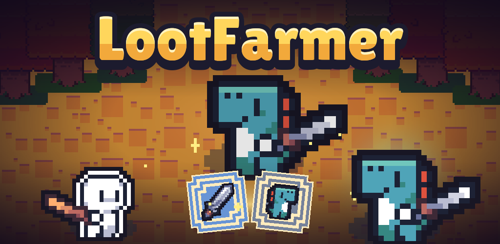

# LootFarmer Change 28: Google Play feature graphic redesign

**Date:** 2026-10-28. **Brief:** `docs/LootFarmer_Feature_Graphic_Creative_Redesign.md`. **Scope:** the feature
graphic only. Icons, screenshots, trailer, gameplay, listing text and the reusable Playbook are unchanged.

## Result



**Store file:** `store_assets/branding/feature_graphic_1024x500.png` (ignored folder; tracked copy
`docs/Change_28_Evidence/feature_graphic_1024x500.png`). 1024 x 500, PNG, mode RGB (24-bit, no alpha channel),
untagged sRGB, 84,995 bytes, SHA-256 `2b57077a7d2e9088f263f74515a79a3f860e15229da691745ea5bc90b5a27560`.

**Direction: "enemy loot becomes your look."** Read left to right: the plain player; the Teal Dinosaur boss
holding its Iron Sword; the two items that boss really drops, in the game's own inventory slots (tier colours,
loot sparkle); the same player now wearing the Dinosaur outfit and holding the Iron Sword. The setting is the
Dinosaur's own Summer map, on warm sand at sunset, so the teal characters stand out against complementary orange
instead of the old green field. The wordmark "LootFarmer" (Lilita One, gold two-tone, dark outline and stepped
depth) is the only text.

Why this pairing: the outfit system makes the player look exactly like the enemy whose outfit they wear
(`world.gd::_visual_look` uses the outfit's sheet as the body), so showing the boss and the outfitted player side by
side *is* the mechanic. The Teal Dinosaur has the most distinctive silhouette and the strongest contrast at
thumbnail size; the Red Fox (tried first) reads as a brown blob when small.

## Research (8 listings fetched 2026-10-28, US English; 7 feature graphics verified)

Feature graphics were taken from each listing's own page data (the 1024 x 500 entry) and checked visually against the
title. Captures stay in the session scratchpad: **not committed, not shipped**. No art, layout, logo, effect or
slogan was copied.

| Game | Listing | Observation | Lesson used |
|---|---|---|---|
| Soul Knight | https://play.google.com/store/apps/details?id=com.ChillyRoom.DungeonShooter | Dozens of pixel weapons on a dark purple swirl, small logo in the middle | Loot can be the subject and pops on a dark saturated field; many small items get busy, so show **two large** items |
| Stardew Valley | https://play.google.com/store/apps/details?id=com.chucklefish.stardewvalley | Pure in-game farm vignette, no title | Authentic tiles sell the look, but an unknown game needs its name and a focal point |
| Archero | https://play.google.com/store/apps/details?id=com.habby.archero | One hero lit by a beam, huge dim villain behind, title to the side | One focal hero, light behind the subject, a large secondary enemy |
| Bit Heroes Quest | https://play.google.com/store/apps/details?id=com.kongregate.mobile.bitheroes.google | Pixel heroes upscaled very large around a central logo badge | Pixel characters must be big; crisp integer scaling holds up |
| Legend of Slime: Idle RPG War | https://play.google.com/store/apps/details?id=com.loadcomplete.slimeidle | A giant boss face over a tiny army, logo in a corner | Scale contrast between boss and heroes tells the story |
| Shattered Pixel Dungeon | https://play.google.com/store/apps/details?id=com.shatteredpixel.shatteredpixeldungeon | The wordmark is the whole graphic, drawn in the game's idiom on dark | A crafted wordmark with depth beats a plain font; dark behind the title |
| Tap Titans 2 | https://play.google.com/store/apps/details?id=com.gamehivecorp.taptitans2 | Diagonal sword slash, hero mid-action, logo badge | The weapon as a strong line gives energy |
| Grow Castle | https://play.google.com/store/apps/details?id=com.raongames.growcastle | The first 1024 x 500 entry on its page belonged to a related app (Stickman & Gun 2) | **Excluded**: no verified feature graphic; recorded, not mislabelled |

Applied: one story with a clear focal order, very large integer-scaled sprites, warm/cool contrast, dark shade
behind the title, two big loot slots instead of scattered icons, the boss larger and further back. No rankings,
conversion or keyword claims are made.

## Three concepts and the selection

Contact sheet: `docs/Change_28_Evidence/feature_graphic_concepts.png` (individual files beside it). Rubric from the
brief: mechanic 30, readability 25, polish 20, art fidelity 15, portrait reuse 10 (internal creative criteria only).

| Concept | Thesis | Score |
|---|---|---|
| A. Before / Loot / After | Plain player, the boss's real drops in slots, the player wearing them | **7.6, selected** |
| B. Wardrobe parade | The player in five boss looks across four seasons | 6.7: variety, but not "from enemies"; season bands read as quadrants |
| C. Boss drop | A towering Red Fox spills its sword and outfit toward the plain player | 6.5: best mood, but the cropped boss is unreadable and no look changes |

A was refined with C's lighting (sunset light, title shade, vignette), then iterated by eye. v1 still had a green
field: Summer sand tiles replaced it. The hero's contact frame (big crescent) hid the face: changed to the wind-up
frame. The boss's light rim looked like a cardboard cutout: replaced with the dark outline. Sparks were too faint:
largest frames, larger scale. Both players moved inward for edge crops. The boss turned to face the player and moved
back so a video play button covers its torso, not its face. Final: 8.55.

## Truthful art (provenance)

All imagery is existing game art at whole-number nearest-neighbour scale. Only colour treatments are added (tint,
darken, 1 source-pixel outline, soft glow, gradient shade, vignette). Nothing is painted, generated or taken from
another game.

| Element | Source | Licence |
|---|---|---|
| Boss, outfitted player, plain player | `assets/PixelPlains/Characters 24x24/Special 3 v1.png` (catalog `boss-teal-dinosaur_outfit` / `_t2` texture), `Basic character v2.png` (the plain player body used by `world.gd`), `Shadow.png` | Pixel Plains (REL-02 record pending) |
| Swords | `assets/PixelPlainsAnimationPack/Iron set/Sword 2 64x32.png` (catalog `iron_sword.attack`), `Wood set/Sword 1 64x32.png`, frame 0 drawn as `actor.tscn` places Attack over Body | Pixel Plains Animation Pack |
| Slot icons | `Items/16x16 All Items v1.png` at `iron_sword.icon`; outfit portrait = its sheet's first cell (catalog `icon`) | Pixel Plains |
| Slot panel | `assets/KenneyFantasyUI/PNG/Default/Panel/panel-014.png` (the theme's Slot style), tinted with `progression.tier_colors` | Kenney, CC0 |
| Sparkle | `assets/PixelPlains/Sparks 25x27.png` (the pickup sparkle) | Pixel Plains |
| Ground, trees | `Summer/Basic Tiles 1.png` sand row, `Summer/Basic Tiles 4 (Trees & Bushes).png` | Pixel Plains |
| Wordmark font | `assets/GUIPackCartoon/Demo/Fonts/LilitaOne - Regular.ttf` (copyright Juan Montoreano, licence embedded in the font) | SIL OFL 1.1; notice `marketing/brand/feature_graphic/licenses/LilitaOne-OFL.txt` |

Game truth is enforced in code: `from_group` makes the composer stop unless the catalog group carries or drops the
item (`iron_sword` and `boss-teal-dinosaur_outfit_t2` are in `boss-teal-dinosaur.loot`; a test with `emerald_sword`
was refused). The graphic is promotional art built from game layers and is not presented as a gameplay screenshot.

## Editable source and reproduction

`marketing/brand/feature_graphic/` (inside `marketing/brand/.gdignore`; `marketing/*` excluded from the Release
export). `compositions/final.json` holds 15 named layers, one per line. `components.json` holds the actors (catalog
ids), wordmark style, slot and tree boxes. Full guide: `marketing/brand/feature_graphic/README.md`.

```powershell
python marketing/brand/feature_graphic/compose_feature_graphic.py           # concepts, final, portrait preview, layer PNGs
python marketing/brand/feature_graphic/make_review.py                       # review sheets + docs/Change_28_Evidence
python marketing/brand/feature_graphic/compose_feature_graphic.py --check   # 1024x500 RGB PNG
```

Every final layer is also written alone, full canvas and transparent, to `store_assets/branding/source_layers/final/`
(and `portrait_endcard_preview/`) for video or image editors. Output is deterministic (a clean rebuild reproduced
the same hash).

## Before / after and small sizes

- `docs/Change_28_Evidence/feature_graphic_before_after.png`: the rejected graphic is the tracked
  `docs/Change_27_Evidence/feature_graphic_1024x500.png` (SHA-256 `907f94f4…6e92b`, unchanged), above the new one.
- `feature_graphic_small_sizes.png`: new and old at 512, 360 (mobile card), 240 and 160 px on light and dark. At
  360 px the name, white player, teal boss, both slots and the outfitted player are distinct. At 160 px the name is
  still legible and the warm/teal contrast keeps the shapes apart (the old one turns into green noise).
- `feature_graphic_overlay_check.png`: a **simulated** centred play button and assumed cutoff bands (10% sides,
  8% top/bottom). Google requires 1024 x 500 JPEG or 24-bit PNG without alpha, a centred focal point and key
  elements out of cutoff zones, and uses the graphic as the video cover with a play button, but publishes **no
  measurements** (support.google.com/googleplay/android-developer/answer/9866151, read 2026-10-28). In the
  simulation the wordmark, slots and both players' bodies stay clear, and the button sits on the boss's torso.

## Future 9:16 trailer end card (plan only)

**No video, storyboard or trailer manifest was touched.** The layered source restages instead of cropping:
`compositions/portrait_endcard_preview.json` renders a static 1080 x 1920 study
(`docs/Change_28_Evidence/feature_graphic_portrait_endcard_preview.png`, **not** the store graphic and **not** a
trailer frame). It uses 90 px side, 220 px top and 300 px bottom safe margins. The wordmark is 168 px Lilita
(about 840 px wide) at y = 640. The boss is x17 at y = 1260, the slots 156 px at y = 1336, and the players x11 and
x14 at y = 1640. Sand is tiled at x5 to fill the height. Suggested motion for the future task: background and boss
fade up from the last shot, the slots drop in with the sparkle animation, the plain player then swaps to the
outfitted one, and the wordmark comes in last and holds at least 1.5 s. Details: the source README.

## Validation

| Check | Result |
|---|---|
| Feature graphic `--check` (size, RGB, PNG, size limit) | PASS; viewed at full size, 512/360/240/160 px, light and dark, with simulated overlays |
| `marketing/brand/compose_brand.py --check` | PASS |
| Icons byte-identical (4 runtime + Play icon, before vs after re-running `compose_brand.py`) | 5/5 identical to the Change 27 manifest |
| Screenshots and trailer vs Change 27 manifest hashes | 24/24 screenshots and the MP4 identical; `finalize_store_assets.py --check` PASS (30.0 s trailer) |
| `python tools/export_manifest.py --check` | PASS, 232 files (unchanged: nothing from this change ships) |
| `python tools/run_probes.py` | **SUITE 36/36 passed** (validator 1,574 checks + export manifest + 34 probe scenes) |

The suite ran once, after the implementation. Later edits touched only `.gdignore`d marketing JSON/Python and docs,
which the game never loads. No AAB was exported and no version bump was made: nothing in the game changed.

## Tooling changes (shared scripts)

- `marketing/brand/compose_brand.py` no longer writes the feature graphic (re-running it for icons would have
  restored the rejected one). Icon output is proven byte-identical; `feature()` and its config stay as the record.
- `marketing/finalize_store_assets.py` no longer copies the feature graphic over
  `docs/Change_27_Evidence/feature_graphic_1024x500.png`, which stays the rejected original. Its screenshot, trailer
  and manifest logic is untouched.

## Limitations and open items

- **Publication not cleared:** Pixel Plains still has no retained licence record (REL-02), as for all store media.
- Lilita One comes from the retired GUI Pack Cartoon demo folder; its own OFL licence permits this use, and its
  notice is now kept beside the source. Brand approval of the actual pixels is the developer's.
- Cutoff and play-button geometry are simulated (Google publishes none); check once in the Play Console preview.
- The research captures are not kept in the repository, by design. Listing URLs and observations are above.
