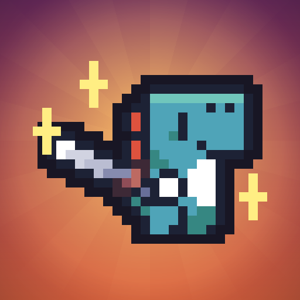
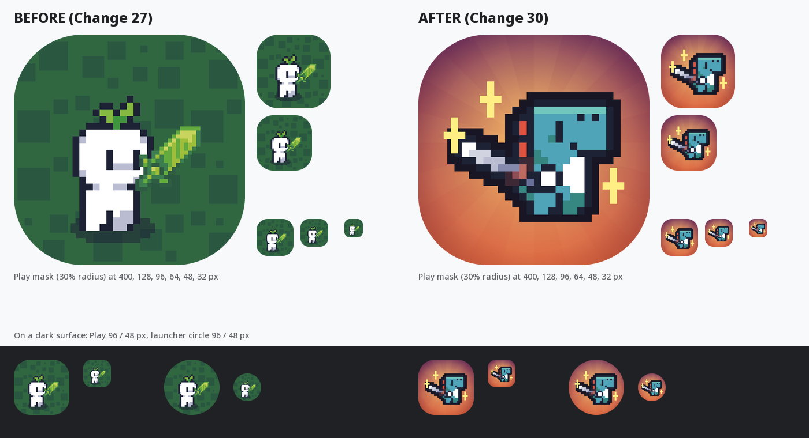
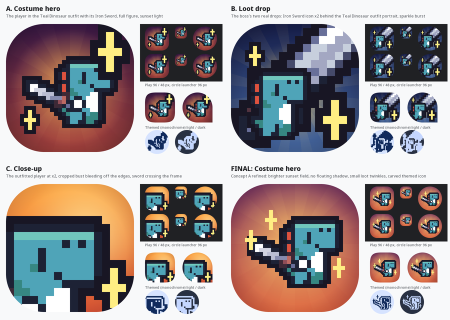
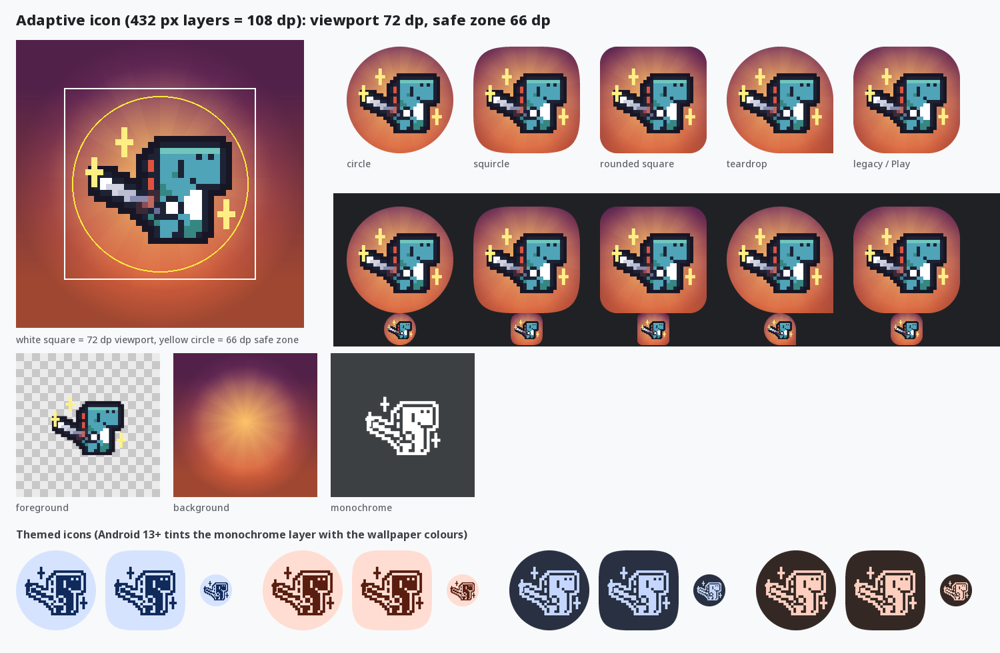
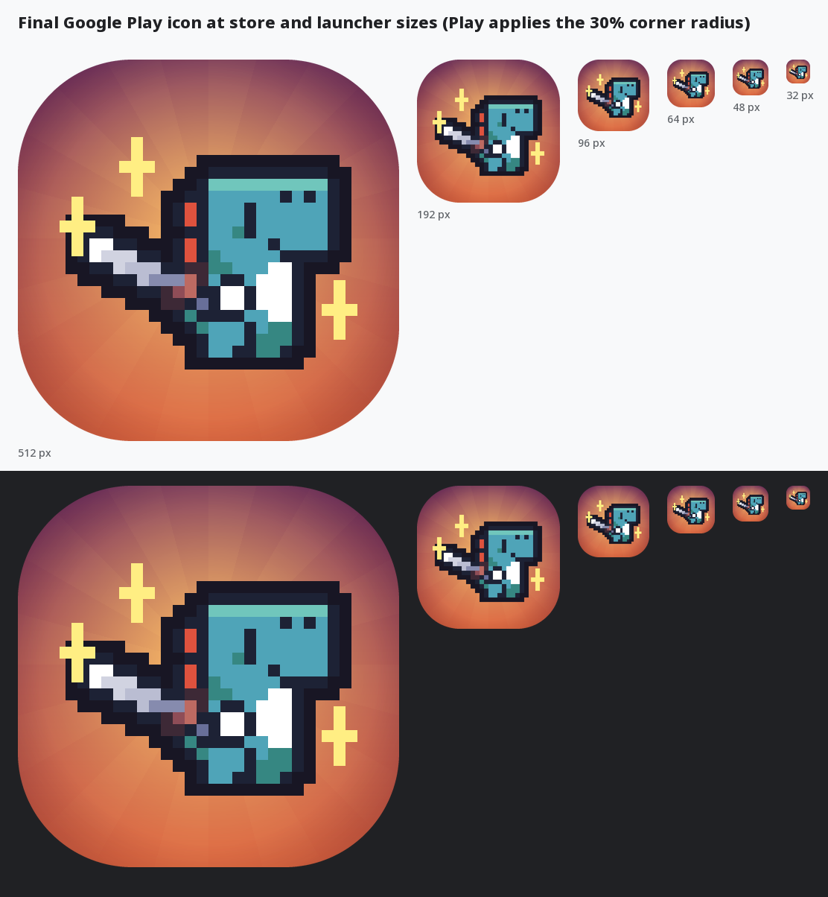

# LootFarmer Change 30: Google Play and Android app icon redesign

**Date:** 2026-10-28. **Brief:** `docs/LootFarmer_App_Icon_Creative_Redesign.md`. **Scope:** the app icon only
(Play icon, Android legacy/adaptive/themed launcher icon). The feature graphic, screenshots, trailer, raw footage,
gameplay, listing text, package identity, version and the reusable Playbook are unchanged.

## Result



**Direction: "costume hero."** The player wearing the **Teal Dinosaur outfit** and holding the **Iron Sword**,
both real drops of the Teal Dinosaur boss, in the game's own attack wind-up frame, lit from behind by an amber
sunset on a plum-to-rust field. Three small loot twinkles from the game's sparkle sheet glint at the blade. No
text (Google Play: no ranking/price/promo text; the name sits beside the icon on every surface).

Why it reads as LootFarmer: in the game, an outfit makes the player look exactly like the enemy it came from
(`world.gd::_visual_look` draws the outfit sheet as the body), so a small hero in a dinosaur costume with that
dinosaur's sword *is* the hook. It is also the character of the approved feature graphic (its right-hand
"after" figure), so the icon and banner share one identity without copying the banner's layout.

Why the Change 27 icon was weaker: a white, low-saturation figure filling about half the tile, on noisy
dark-green grass tiles, holding a green sword that disappears into the green field at 48 px; no visible link
to the loot-outfit mechanic, and the same green as countless farming icons.



| File | Spec (verified on the written file) | SHA-256 |
|---|---|---|
| `store_assets/branding/play_icon_512.png` (ignored; tracked copy `docs/Change_30_Evidence/play_icon_512.png`) | PNG, 512 x 512, RGBA 32-bit, alpha 255 everywhere, no ICC profile, 74,120 B | `6176493867e220104a72938f9df38d50d2506336ebc4c7712f5e04d61cf8e82c` |
| `assets/branding/launcher_192.png` (legacy + `config/icon`) | PNG, 192 x 192, RGBA, opaque, 21,122 B | `a45caae40e52abade0d74203c51e40aef1af54cb573a31b9ce5b07e9d3dbf3d2` |
| `assets/branding/adaptive_background_432.png` | PNG, 432 x 432, RGBA, opaque, 69,656 B | `d6b74dd26216870c1609b6296c4cb5a1ef8168fa1dc040877a85188550fcf629` |
| `assets/branding/adaptive_foreground_432.png` | PNG, 432 x 432, RGBA, transparent, 1,761 B | `059ff4f798a8b9b6b6c60fdda37038ba32dea322cd6418a9e5c4872f9e6cad8e` |
| `assets/branding/adaptive_monochrome_432.png` | PNG, 432 x 432, white on transparent, 1,631 B | `6790049cd3539e5f10b24989165f366210b26e95009649a8a6a2f191007ab6f9` |

## Official requirements (checked 2026-10-28)

- **Play** ([preview assets](https://support.google.com/googleplay/android-developer/answer/9866151?hl=en),
  [icon design specifications](https://developer.android.com/google-play/resources/icon-design-specifications)):
  512 x 512, 32-bit PNG with alpha, sRGB, max 1024 KB; full square, *Google Play applies a corner radius of
  30% of the icon size and its own drop shadow*, so neither is baked in; no transparent background
  recommended; artwork may fill the square ("illustrated artwork typically works well as a full bleed icon");
  no text or graphics suggesting ranking, deals, Play programmes or misleading claims. All previews here use
  the 30% radius (the Change 27 previews used 20%).
- **Adaptive** ([adaptive icon design](https://developer.android.com/develop/ui/compose/system/icon_design_adaptive)):
  layers 108 x 108 dp; outer 18 dp per side reserved for masks and motion (so a 72 dp viewport); "the 66x66
  safe zone ... is never clipped by a shaped mask"; foreground and background required, monochrome for
  Android 13+ themed icons; no masks or outline shadows on the layers.
- **Godot 4.7.2 Android export:** `launcher_icons/main_192x192` (legacy icon, used below API 26 and as the
  source of Godot's splash icon) and the three `adaptive_*_432x432` layers (432 px = 108 dp at xxxhdpi). Min
  SDK is Godot's default 24, so the legacy icon is still needed.

## Research: 15 current Google Play icons (fetched 2026-10-28, en-US)

Each icon was taken from its listing's own `itemprop="image"` / `og:image` entry (the app icon, not a feature
graphic or screenshot), downloaded at 512 px to a scratch folder (not committed, not in the export) and viewed
at 512, 96 and 48 px. Observations are mine; no ranking or conversion claims.

| # | Game (developer) | Listing | What the icon does |
|---|---|---|---|
| 1 | Soul Knight (ChillyRoom) | [com.ChillyRoom.DungeonShooter](https://play.google.com/store/apps/details?id=com.ChillyRoom.DungeonShooter&hl=en) | Dark hooded hero face with glowing eyes, two curved weapons framing it, teal radial glow; face legible at 48 px |
| 2 | Shattered Pixel Dungeon (Shattered Pixel) | [com.shatteredpixel.shatteredpixeldungeon](https://play.google.com/store/apps/details?id=com.shatteredpixel.shatteredpixeldungeon&hl=en) | One huge pixel chest, full bleed, chunky pixels; survives any size, but a generic loot symbol |
| 3 | Stardew Valley (ConcernedApe) | [com.chucklefish.stardewvalley](https://play.google.com/store/apps/details?id=com.chucklefish.stardewvalley&hl=en) | One cream pixel chicken on a flat blue field; complementary contrast, nothing else |
| 4 | Legend of Slime: Idle RPG War (LoadComplete) | [com.loadcomplete.slimeidle](https://play.google.com/store/apps/details?id=com.loadcomplete.slimeidle&hl=en) | Mascot face filling 80%, crown as the only accessory, blue on green; an expression you read at 48 px |
| 5 | Tap Titans 2 (Game Hive) | [com.gamehivecorp.taptitans2](https://play.google.com/store/apps/details?id=com.gamehivecorp.taptitans2&hl=en) | Huge green titan face behind a small hero; dramatic but the hero is lost when small |
| 6 | Archero (Habby) | [com.habby.archero](https://play.google.com/store/apps/details?id=com.habby.archero&hl=en) | Bow and arrow on bright green with a temporary "7th Anniversary" overlay (event art, text) |
| 7 | Grow Castle (RAON GAMES) | [com.raongames.growcastle](https://play.google.com/store/apps/details?id=com.raongames.growcastle&hl=en) | The tower itself, illustrated, centred on sky; the game's core object as the icon |
| 8 | Idle Slayer: Pixel RPG (Pablo Leban) | [com.pabloleban.IdleSlayer](https://play.google.com/store/apps/details?id=com.pabloleban.IdleSlayer&hl=en) | One pixel sword on flat orange; the clearest at 48 px of the set: one object, cool on warm |
| 9 | Otherworld Legends (ChillyRoom) | [com.chillyroom.zhmr.gp](https://play.google.com/store/apps/details?id=com.chillyroom.zhmr.gp&hl=en) | Pixel wolf warrior with red blade on yellow-orange fire; strong colour, busy silhouette |
| 10 | LOOTFALL: Idle Retro RPG (Demonfork) | [com.demonfork.lootfall](https://play.google.com/store/apps/details?id=com.demonfork.lootfall&hl=en) | Pixel demon head on flat maroon; minimal, but dark-on-dark loses detail small |
| 11 | Idle Pixel Heroes (MAD PIXEL) | [com.kkgames.pixelheroes](https://play.google.com/store/apps/details?id=com.kkgames.pixelheroes&hl=en) | Pixel reaper with scythe and dice on dark teal; dark subject on dark field fades at 48 px |
| 12 | Slayer Legend: Idle RPG (GEAR2) | [com.gear2.growslayer](https://play.google.com/store/apps/details?id=com.gear2.growslayer&hl=en) | Pixel hero face and scarf in motion over a teal swirl; face first |
| 13 | Dunidle: Offline Pixel RPG (ARMII Games) | [aratnon.pixel.idle.dungeon.dunidle](https://play.google.com/store/apps/details?id=aratnon.pixel.idle.dungeon.dunidle&hl=en) | One pixel eye monster on a cyan burst; monster as mascot, burst for energy |
| 14 | Pixel Knights: Idle RPG (SUPERBOX) | [com.superpixel.pixelknights](https://play.google.com/store/apps/details?id=com.superpixel.pixelknights&hl=en) | High-detail anime portrait (not pixel art despite the name); polished but generic for the genre |
| 15 | Dungeon Loot (Running Pillow) | [com.runningpillow.dl](https://play.google.com/store/apps/details?id=com.runningpillow.dl&hl=en) | Glowing chest inside a gold frame; reads as "loot" but is the genre's most common motif |

**Lessons applied** (principles only; no art, layout or symbol copied):

1. **One subject, large.** The strongest small-size reads (Idle Slayer, Stardew, Slime, Shattered PD) show a
   single object or face at 70 to 90% of the tile. Scenes with two subjects (Tap Titans) lose one.
2. **Complementary field.** Cool subject on a warm field or the reverse (Idle Slayer, Stardew, Slime). Dark on
   dark (LOOTFALL, Idle Pixel Heroes) and the old LootFarmer icon's green on green fade at 48 px.
3. **A face.** Faces and eyes are what read first (Soul Knight, Slime, Slayer Legend, Dunidle).
4. **Light behind the subject** (Soul Knight, Dunidle, Dungeon Loot): a radial glow separates the focal point
   from the edges without needing scenery.
5. **Pixel art at big pixels survives.** Shattered PD, Stardew and Idle Slayer use few, large pixels; they stay
   crisp where illustrated detail turns to texture.
6. **Avoid the generic loot symbol.** Chests (2, 15) and lone swords (8) say "RPG" but not *which* game; our own
   distinctive asset is the costume.
7. **No text** on 14 of 15 (Archero's is a time-limited event overlay).

Finally the candidate was placed among these 15 at 72 px on white and dark surfaces (scratch only). The first
refinement was the darkest tile in the row and receded on dark; the field was brightened in response.

## Concepts (three, rendered by the same tooling) and selection



Rubric (written before scoring; internal quality criteria, not conversion claims): small-size legibility 30%,
game identity/mechanic 25%, distinctiveness beside the researched icons 20%, polish 15%, adaptive/themed
robustness 10%. Marks in `marketing/brand/icon/concept_scores.json`.

| Concept | Idea | Score | Verdict |
|---|---|---|---|
| **A. Costume hero** (selected) | The outfitted player full figure, sword wind-up, warm light | 7.50 | Silhouette, face and blade all survive 48 px |
| B. Loot drop | The boss's two real drops: Iron Sword icon x2 behind the outfit portrait, gold burst | 5.75 | The sword dominates, the dinosaur becomes a detail; portrait outside the 66 dp safe zone (16.3 of 14.67 units), sword clipped by every mask |
| C. Close-up | The outfitted player at x2, cropped bust | 5.00 | Bold, but the crop removes the T-rex silhouette, sword and costume; a teal block with eyes at 48 px |
| **Final** (A refined) | | 8.40 | |

Refinements from A to final, each made after looking at the rendered pixels: unit-stepped glow and rays read as
blocky noise, so treatments became smooth; the actor shadow looked like a brown blob without ground, so it was
removed; a 2x sparkle read as a medical "+", so three 1x twinkles at the blade replaced it; the field was
brightened after the in-context check; the themed icon first broke into fragments (every dark pixel cut), then
became a blob (2 units of outline kept), and finally keeps 1 unit of outer outline and carves interior detail.

## Android masks, sizes and themed icon



- **Safe zone (measured):** the hero (key layer) reaches 13.82 units from the centre; the 66 dp safe circle is
  14.67 units. All foreground art lies inside the 72 dp viewport (bbox 104..329 x 131..306 px of 432).
- **Masks:** circle, squircle, rounded square, teardrop and the legacy/Play square at 160 and 48 px on light
  and dark: nothing important clipped; the face stays centred. Play's 30% radius only trims background.
- **Themed icon:** four wallpaper tints (light blue, light peach, dark navy, dark brown), circle and squircle,
  plus 48 px: a clean outline drawing of the dinosaur with its sword and twinkles.
- **Sizes:** `Change_30_Evidence/icon_small_sizes.png` (512, 192, 96, 64, 48, 32 px, light and dark).



## Art provenance and rights

All picture content is existing game art, scaled by whole numbers with nearest-neighbour sampling, through the
feature graphic's engine (same truth guard: the composer refuses an outfit or weapon the named enemy does not
carry or drop):

- `assets/PixelPlains/Characters 24x24/Special 3 v1.png`: Teal Dinosaur outfit, frame [0, 0] (catalog
  `boss-teal-dinosaur_outfit_t2`, dropped by `boss-teal-dinosaur`).
- `assets/PixelPlainsAnimationPack/Iron set/Sword 2 64x32.png`: Iron Sword swing frame 0 (catalog `iron_sword`,
  carried and dropped by `boss-teal-dinosaur`), placed as `scenes/game/actor.tscn` places it.
- `assets/PixelPlains/Sparks 25x27.png`: one 3 x 5 twinkle from frame 0 (the in-game loot sparkle).
- Gradient, rays, glow and vignette are colour treatments; the 1-pixel dark rim is the feature graphic's. No
  font, no AI-generated imagery, no stock or competitor art.

**Open record (unchanged, REL-02):** Pixel Plains and its Animation Pack have no retained licence/purchase
record in the repository (only `ReadMe.txt`). The icon uses the same packs as the game and the approved feature
graphic; publication still waits for that record.

## Editable source and reproduction

`marketing/brand/icon/` (tracked, import-ignored, never exported): `compose_icon.py`, `compositions/final.json`
(6 layers, one per line) and the three concepts, `concept_scores.json`, `README.md` (editing guide, layer table,
the 32-unit grid). Every final layer is also written alone to `store_assets/branding/source_layers/icon_final/`.

```powershell
python marketing/brand/icon/compose_icon.py            # concepts, final, review sheets, evidence copies
python marketing/brand/icon/compose_icon.py --check    # format + safe zone + fresh render equals the written bytes
```

**Traps fixed (the Change 28 pattern):** `marketing/brand/compose_brand.py` still rendered the Change 27 icon
into the runtime and store paths; it now refuses unless given `--legacy-change-27` (its `--check` remains for
the store finalizer). `marketing/finalize_store_assets.py` in write mode copied the current icon and previews
over `docs/Change_27_Evidence/`; those three copies were removed, so that folder keeps the rejected original.

## Integration

Same runtime paths as Change 27, so `project.godot` (`config/icon`), `export_presets.cfg` (`launcher_icons/*`),
`tools/export_rules.json` and `tools/export_manifest.json` are **unchanged** (generator check: 232 files). No
version bump: nothing in the release/tool contract requires one for art (Release stays version code 27).

A local test export (not a release delivery, not uploaded):
`godot --headless --export-release "Android Release" builds/LootFarmerIdleRPG.27-icon30.aab` (59,245,140 B),
then `python tools/verify_export.py ... --baseline builds/LootFarmerIdleRPG.27.aab`: **PASS** (package and
version identical, minSdk 24, targetSdk 36, ARM ABIs only, 232 packed sources = manifest). The AAB's
`base/res/mipmap-{mdpi..xxxhdpi}-v4/icon*.webp`, `mipmap-anydpi-v26/icon.xml` and `themed_icon.xml` were
extracted and viewed: all carry the new art. `export_presets.cfg` and `project.godot` were byte-identical after
the export.

## Verification

| Check | Result |
|---|---|
| `compose_icon.py --check` (PNG signature, size, RGBA, opacity, no ICC, <= 1024 KB, safe zone, viewport, fresh render byte-identical) | PASS |
| `compose_brand.py --check`, `compose_feature_graphic.py --check`, `finalize_store_assets.py --check` | PASS, PASS, PASS (24 screenshots, 30.0 s trailer) |
| `tools/export_manifest.py --check` | PASS (232 files) |
| `tools/verify_export.py` on the test AAB | PASS |
| Protected media (feature graphic + layers, screenshots, raw captures, videos, Change 27/28 evidence: 140 files) | SHA-256 identical before and after; feature graphic still `2510ca43…0775f` |
| `python tools/run_probes.py` (maintained suite, once at the end) | **SUITE 36/36 passed** (includes `change_27_probe`: launcher icons set, loading and shipping; `change_26_probe`: export allowlist) |

## Open items

- Developer pixel approval of the final icon, then a Play Console preview check (Play draws the mask and shadow).
- A physical-device look at the launcher icon and themed icon (one Android 13+ phone); this batch verified the
  packaged resources, not a home screen.
- REL-02 licence records (Pixel Plains, Animation Pack) before publication.
- Playbook: not updated in this batch, by instruction.
