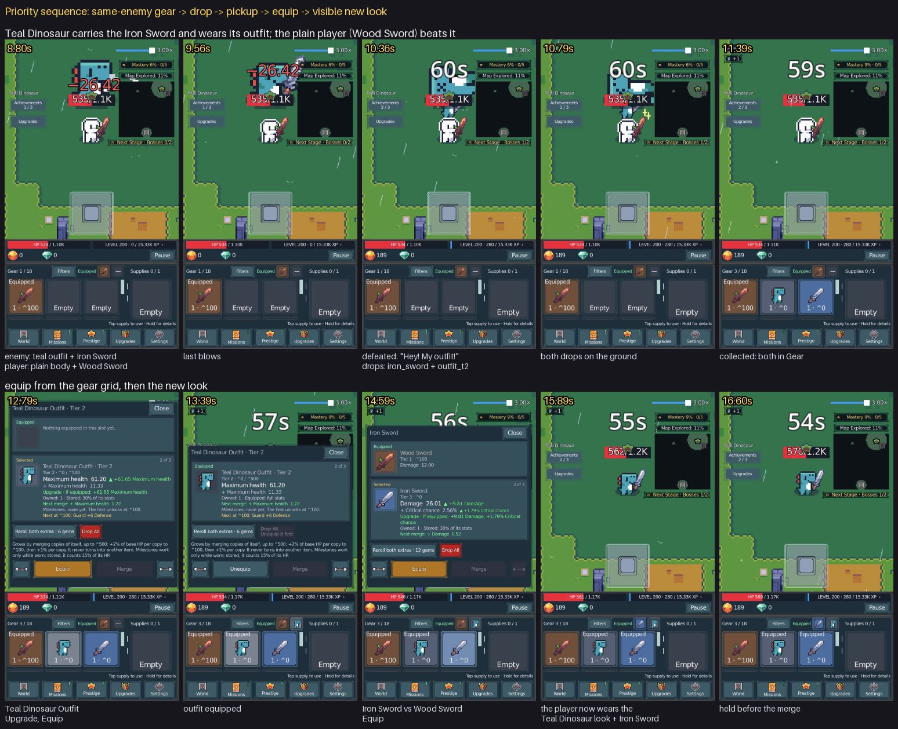
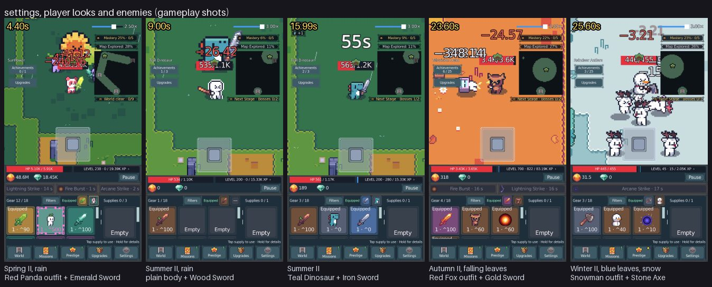
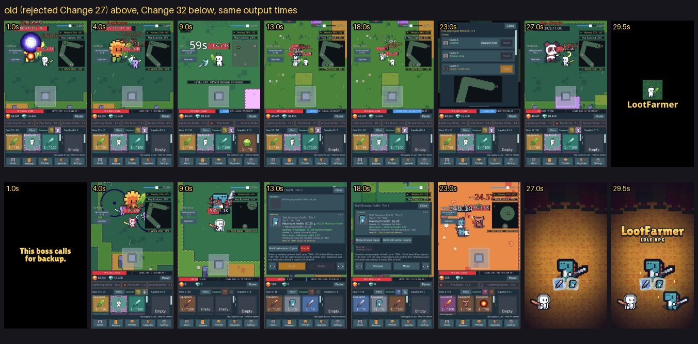

# LootFarmer Change 32: Google Play store trailer redesign

**Date:** 2026-10-28. **Brief:** `docs/LootFarmer_Change_32_Store_Trailer_Redesign.md`. **Baseline:** Change 31
(`8a24319`), clean worktree. **Scope:** the 30 s portrait Google Play trailer only. Screenshots, icon, feature
graphic, gameplay, balance, UI, saves, localization, listing copy, Android version and the reusable Playbook are
unchanged. Nothing was uploaded, published or pushed.

## Result

**`store_assets/video/LootFarmer_Play_Trailer_en-US.mp4`**: 1080 x 1920 portrait, 30 fps, 900 frames, 30.000 s,
H.264 High `yuv420p` (limited range), one AAC 48 kHz stereo stream (music only), no rotation, `moov` before `mdat`
(faststart), 5,959,335 B, SHA-256 `2076dfea9b277b2951c71ade74511d838cd816b0dd41dc5b3503ff7d2ac3b09f`.

The story a new viewer sees: a boss calls for help while the player fights back with skills; the player beats
an enemy dressed as a teal dinosaur, picks up that enemy's outfit and sword, equips both from the inventory and
now looks like that dinosaur; one merge makes the outfit stronger; then two more seasons with other enemies and
other looks; then the title card, which recaps the same dinosaur story in the feature graphic's art.

### Timeline and title-card copy

| Out (s) | Shot | Proof (take event, output time) |
|---|---|---|
| 0.00 to 2.30 | Black card **"This boss calls for backup."** | fully readable 0.20 to 1.70 (1.53 s measured), black level 1 of 255 |
| 1.90 to 6.10 | Spring II, real rain: the **Sunflower** (`boss-sunflower`) | player Lightning Strike 2.19; **summon of two `unit-sprout` helpers 3.53** (telegraph and portal visible before, helpers arrive on screen); Fire Burst 4.59; Arcane Strike 5.69 |
| 5.70 to 8.80 | Black card **"Defeat an enemy and wear its gear."** | 6.30 to 8.20 (1.93 s) |
| 8.40 to 17.10 | Summer II, rain: **Teal Dinosaur** (`boss-teal-dinosaur`, body `boss-teal-dinosaur_outfit`, weapon `iron_sword`) | player in the plain body with `wood_sword` fights it from 8.40; **defeat 10.06** (it says "Hey! My outfit!"), drops `iron_sword` + `boss-teal-dinosaur_outfit_t2`; **pickups 10.89 / 11.19**; outfit panel (Upgrade, +61.65 Maximum health) 11.69, **Equip 13.09**; Iron Sword vs Wood Sword panel 13.79, **Equip 14.89**; panel closed and **new look (teal dinosaur + Iron Sword) on screen from 15.39** until the merge panel at 17.13 |
| 16.70 to 20.10 | Summer II, crossfade from the same look | outfit tile tapped 17.13; **"Merge 40 spare copies" 18.63**: tile `41 · ^0` to `1 · ^40`, Maximum health 61.20 to 110.16 (player 1,156 to 1,205 HP); result readable 18.63 to 19.70 |
| 19.70 to 22.80 | Black card **"Every season has new gear to farm."** | 20.30 to 22.20 (1.93 s) |
| 22.40 to 24.70 | Autumn II, falling leaves | Red Fox outfit + Gold Sword, Fire and Lightning, TV Heads, Auto-Collect |
| 24.30 to 26.60 | Winter II, snow and blue leaves (crossfade) | Snowman outfit + Stone Axe, Reindeer Antlers and Space Helmets, loot line from a dropping enemy |
| 26.20 to 30.00 | Portrait end card from the approved feature graphic | Teal Dinosaur, its two loot slots, the plain player, then the outfitted player; **LootFarmer** wordmark full from 27.80, **IDLE RPG** from 28.00; held to 30.00 |

Every gameplay take and event is from the game's own simulation (Godot Movie Maker, real portrait window,
`capture-store` profile, `--no-autosave`); each take's `.avi.log` records the events above. Variety by chapter:
Spring II green with purple trees and rain; Summer II green with rain; Autumn II orange and red; Winter II snow.
Players: Red Panda + Emerald Sword, plain + Wood Sword then Teal Dinosaur + Iron Sword, Red Fox + Gold Sword,
Snowman + Stone Axe. Enemies: Sunflower and Sprouts, Teal Dinosaur, TV Heads, Reindeer Antlers and Space Helmets.
No Prestige screen or banner, no final boss (Green Alien never shown).

### Before and after

The rejected Change 27 cut (kept in `store_assets/video/rejected_change_27/`) was seven green Spring II shots,
menus (World, Prestige), small characters, game sound under the music and an icon-and-name card. The new cut
has three explained chapters, one long coherent equipment story, four different maps and looks, music only and
a composed title card.

## How it was made

- **Toolkit:** Godot Marketing Capture Toolkit 1.0.2, unchanged (`marketing.py status`: 11 files identical to
  the lock and the toolkit source). Takes recorded with `marketing.py record`, cut with `marketing.py video`.
- **Adapter (`marketing/game_scenarios.gd`):** `_stage_profile` builds a first-run profile at any map through
  the simulation's own calls; history fixtures (earlier kills, the Teal Dinosaur beaten once before without the
  drop, two Prestige opportunities a player at that map met long ago) keep the game from raising Prestige banners
  during a take. The take logs every banner (`MILESTONE`); none was raised on screen. New scenarios:
  `trailer_gear`, `trailer_merge`, `trailer_farm`; `boss_sunflower` takes an `outfit` option.
- **Gear drop:** never forced. The Teal Dinosaur's real kill rolls each loot item at 37.5% (15 Loot upgrades);
  seed 3209 was found by searching drafts for a kill that drops both. The take is deterministic (identical event
  frames across draft and master).
- **Staging:** the world view's upper corners are covered by the HUD's side buttons and minimap, so bosses stand
  straight above the player; leaves are sparse in the game, so the farming spots were chosen where the fixed leaf
  pattern crosses the open ground during the shot.
- **End card:** `marketing/trailer/compose_end_card.py` animates `portrait_endcard_preview.json` (the approved
  feature graphic's 9:16 restaging, unchanged) with the feature-graphic composer's own layer painters; the stacked
  layers and the final frame are verified pixel-identical to the static study.
- **Title cards:** Lilita One (the wordmark's font, SIL OFL) in the brand gold on black; reading time 18
  characters per second, at least 1.5 s fully visible, text only on black (Playbook 133.2).
- Sources, tables and commands: `marketing/trailer/README.md`.

## Music only

- Source: `assets/sounds/background_music.wav`, SHA-256 `b3664d04791bb86f220b790823dab34ec6912ba93a1a60cf035e82b557b45778`,
  identical to the developer's handoff; 132.41 s, 44.1 kHz, 16-bit stereo. No other music, no Pixabay, nothing
  generated.
- One continuous section from 60.00 s (a strong onset after the intro, whose silent rests would sound like
  dropouts under the first card) to 90.00 s; the track's louder section (86.07 s) lands at 26.07 s, under the
  end card. Volume 0.85, 30 ms fade-in, 1.8 s fade-out, limiter at -1 dBFS.
- **Game audio excluded at source:** the manifest sets `game_audio: false`, so the toolkit encodes every gameplay
  segment with `-an` and the final FFmpeg graph maps only `[aout]`, built from the WAV input alone. The masters'
  PCM game sound is never read.
- **Verified on the MP4:** one audio stream; peak -2.2 dBFS; no window below -27 dB (no dropout under cards or
  cuts); the decoded audio minus the WAV section leaves a residual of -25.7 dB median, -16.9 dB at worst (AAC
  coding and the limiter), in every shot including the boss, gear, merge, cards and end card: there is no sound
  that is not the WAV. Waveforms: `Change_32_Evidence/audio.jpg`. This is a signal comparison, not a listening
  test: a listen on a phone remains with the developer.

## Validation

| Check | Result |
|---|---|
| ffprobe | h264 High, yuv420p, 1080x1920, SAR 1:1, 30/1, 900 frames, 30.000 s; aac 48 kHz stereo 30.000 s; rotation 0; faststart |
| Frame decode (toolkit + `review_trailer.py`) | 8/8 transitions smooth (largest single step 24.3 of a 132 change); cards on true black (level 1); 3/3 card texts readable 1.53/1.93/1.93 s; no black bars on any gameplay shot; the two flagged abrupt luma changes (11.73 s, 17.17 s) are the game's item panel opening in play, not edits |
| Gameplay contracts | all 14 timeline events found in the take logs (summon, skills, defeat with both drops, pickups, both equips, new look, merge); no banner on screen |
| Protected assets | feature graphic, Play icon and all 24 screenshots match their recorded SHA-256 (25 files); `assets/branding`, `icon.svg`, game scripts, scenes, data, resources and `assets/sounds` unchanged in Git |
| Export allowlist | `tools/export_manifest.py --check`: PASS, 232 files (unchanged); `marketing/*` still excluded. No AAB rebuilt (no shipped file changed) |
| Toolkit | `marketing.py status`: 1.0.2, 11 files identical to the lock |
| Maintained suite | `python tools/run_probes.py`: **SUITE 36/36 passed**, run once at the end of the batch |

During the batch, `project.godot` and `export_presets.cfg` were overwritten at 15:23 with an older state (version
25, empty launcher icon fields): the signature of a Godot editor saving stale settings, not of the capture runs.
Both were restored from the Change 31 commit before validation; neither is part of this change.

## Evidence (`docs/Change_32_Evidence/`, full size in `store_assets/video/review_c32/`)

`contact_sheet` (every shot first/middle/last), `card_holds` (each card mid-hold, full size), `phone_strip`
(every 0.5 s at 180x320), `transitions` (each transition frame by frame), `gear_sequence`, `summon`, `variety`,
`old_vs_new`, `end_card` (last 3.5 s), `end_card_final`, `audio`, `validation.json` (all numbers above),
`trailer_review.json` / `trailer_review_half.jpg` (the toolkit's own report).

## Kept for reuse

Masters `store_assets/raw/video/trailer_c32/c32_{boss,gear,merge,autumn,winter}.avi` with logs (about 240 MB),
`end_card.mkv`, end-card layers and 360x640 drafts; the Change 27 clips; the editable sources in
`marketing/trailer/`. A recut (copy, timing, music in-point, social formats) needs no new recording.

## Open for the developer

1. **Watch and listen** to the MP4 on a phone: pacing, card wording, music level. Approve or request changes.
2. **REL-02 rights:** no licence or purchase record exists in the repository for `assets/sounds` (this music) or
   for Pixel Plains art. Do not upload the trailer to YouTube or Play until they are recorded.
3. Weather is the game's own and sparse: rain reads clearly; falling leaves are small and visible mainly in motion.
4. Summer II and Spring II are both green under rain; the chapters are separated by a black card and differ in
   trees, bosses and looks, but they are the closest pair in the film.
5. The Playbook was not changed. Candidate lessons after review (see "How it was made" and Validation): stage
   the action around the HUD's covered corners; find a real drop by seed search, never force it; give a staged
   profile the history that keeps the game from raising banners mid-take, and log banners; check
   `project.godot`/`export_presets.cfg` after long Godot sessions.
