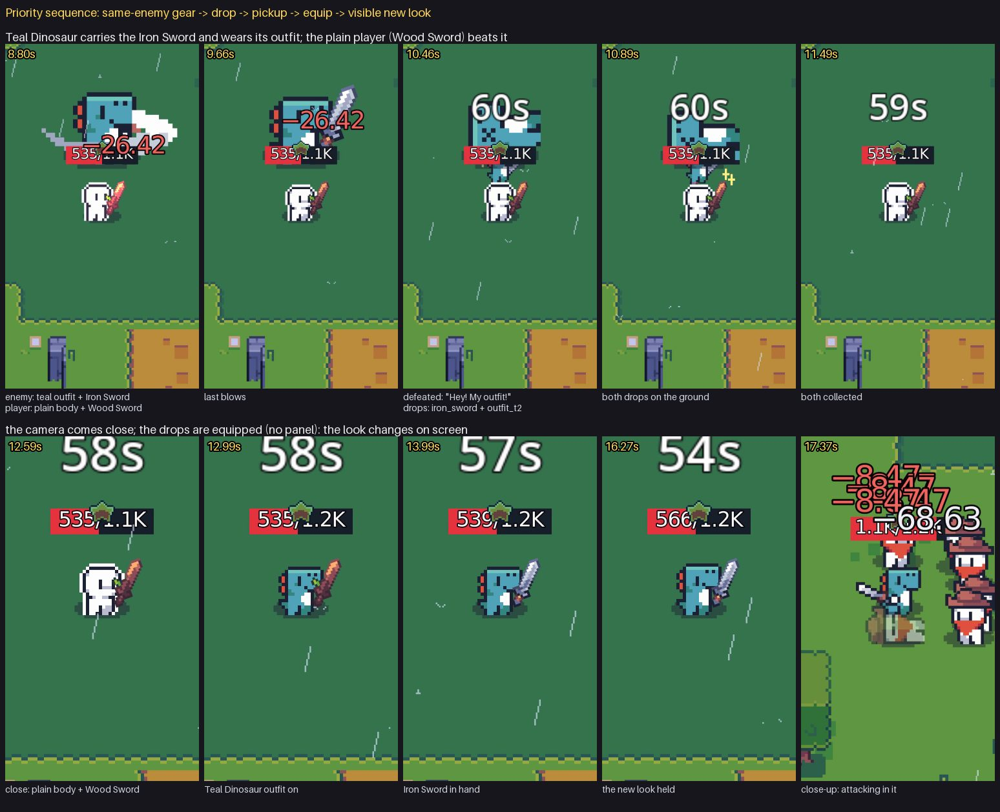
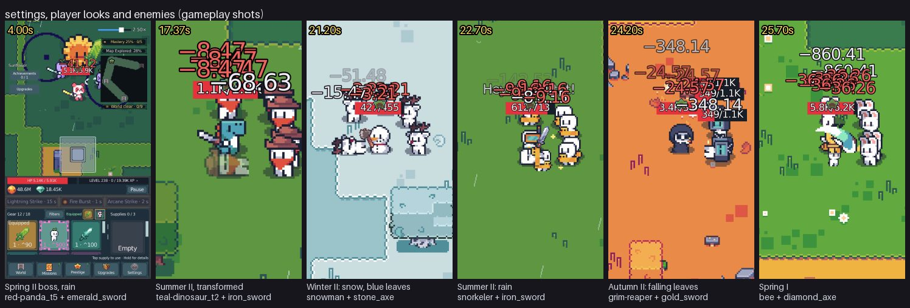

# LootFarmer Change 33: store trailer revision (transformation and four seasons)

**Date:** 2026-10-28. **Request:** the developer's revision of the Change 32 trailer (no new brief file).
**Baseline:** Change 32 (`556c15b`). **Scope:** the trailer cut and its new takes only. Opening boss chapter,
title cards 1 and 2, music, transitions method and end card are kept; icon, feature graphic, screenshots,
gameplay, balance, UI and the Playbook are unchanged. Nothing was uploaded, published or pushed.

## Result

**`store_assets/video/LootFarmer_Play_Trailer_en-US.mp4`**: 1080 x 1920, 30 fps, 900 frames, 30.000 s, H.264 High
`yuv420p`, one AAC 48 kHz stereo stream (music only), faststart, 8,565,052 B, SHA-256
`f39f8232641c0c9eded1861e5ac677a2dc23dd7a2a36a88a29bec023f03d6094`. The Change 32 cut is kept, re-rendered
byte-identical (`2076dfea...`) from its committed manifest, in `store_assets/video/change_32/`.

| Requested change | Done |
|---|---|
| Transformation without the equipment panel, closer camera | New take `c33_gear`: the same Teal Dinosaur fight (seed 3209, identical simulation: defeat, both drops, pickups on the same frames), as a **clean shot** (HUD hidden, the world fills the frame) at zoom 4.2; after the pickups the camera pushes in to 6.0 and the two drops are equipped through `sim.equip()`, the call behind the panel's Equip button, with no panel on screen. The plain white player becomes the Teal Dinosaur (12.79 s), then takes the Iron Sword (13.79 s), and holds the look |
| Remove stats and merge (16 to 20 s) | Merge shot removed; a **1.8 s close-up** (`c33_closeup`, zoom 5.5) of the Teal Dinosaur outfit and Iron Sword attacking a Cowboy Bandana pack |
| All four seasons, different looks | Card "Each season has its own gear." then **Winter** (Winter II snow and blue leaves, Snowman + Stone Axe, Reindeer Antlers), **Summer** (Summer II rain, Snorkeler + Iron Sword, Duck Swim Rings), **Autumn** (Autumn II falling leaves, Grim Reaper + Gold Sword, TV Heads), **Spring** (Spring I, Bee + Diamond Axe, Bunny Ears): 1.8 s each, 0.3 s crossfades, no black between seasons. Four different outfits and four different weapons (checked by `review_trailer.py`) |
| Map smaller or hidden (developer note) | Hidden in every new take, with the rest of the HUD (minimap, side buttons, labels, joystick, bottom rows) |

## Timeline (output seconds)

| Out | Shot | Proof |
|---|---|---|
| 0.00 to 2.30 | card "This boss calls for backup." | readable 1.50 s, black level 1 |
| 1.90 to 6.10 | Sunflower boss, Spring II rain (Change 32 take) | Lightning 2.19, summon of two Sprouts 3.53, Fire 4.59, Arcane Strike 5.69 |
| 5.70 to 8.80 | card "Defeat an enemy and wear its gear." | readable 1.90 s |
| 8.40 to 16.77 | Teal Dinosaur, Summer II rain, clean | defeat 10.16 (drops `iron_sword` + `boss-teal-dinosaur_outfit_t2`), pickups 10.99 / 11.29, push-in 11.59, **outfit on 12.79**, **Iron Sword on 13.79**, new look held to 16.77 |
| 16.47 to 18.27 | close-up attack (crossfade) | Teal Dinosaur outfit + Iron Sword swinging |
| 17.87 to 20.70 | card "Each season has its own gear." | readable 1.63 s |
| 20.30 to 22.10 | Winter | Snowman + Stone Axe; blue leaves in frame (spot computed from the leaf pattern) |
| 21.80 to 23.60 | Summer | Snorkeler + Iron Sword; rain |
| 23.30 to 25.10 | Autumn | Grim Reaper + Gold Sword; falling leaves |
| 24.80 to 26.60 | Spring | Bee + Diamond Axe |
| 26.20 to 30.00 | end card (unchanged) | LootFarmer / IDLE RPG |

Weather in motion: `Change_33_Evidence/weather.jpg` (four consecutive frames per season: rain streaks and drifting
leaves change position frame to frame).

## Method notes

- **Clean takes:** `marketing/game_scenarios.gd` puts the HUD in the toolkit's `ui_group` and keeps it hidden
  for takes with `clean: true` (Playbook 87.2 intentional clean shot); the world view then fills the 9:16 frame.
  Without the zoom slider on screen the camera may come closer than the slider's 3x: `SettingsState.camera_zoom`
  is set directly for the take (never saved), the same follow camera. No game file changed.
- **Equipping:** `_equip_direct` calls `sim.equip(id)`; the take log records `EQUIP_DIRECT ... ok=true` with the
  resulting weapon and outfit. The drop is not forced (the Change 32 seed search).
- **Kept:** all Change 32 takes (`c32_*.avi`, including the panel version of the gear story and the merge) and
  the Change 27 clips remain in `store_assets/raw/video/`; the manifest still describes how to re-record them.

## Validation

| Check | Result |
|---|---|
| ffprobe | h264 High yuv420p 1080x1920 SAR 1:1, 30/1, 900 frames, 30.000 s; aac 48 kHz stereo 30.000 s; rotation 0; faststart |
| Frame decode | 10/10 transitions smooth; cards on true black; 3/3 cards readable (1.50 / 1.90 / 1.63 s); no black bars; **no abrupt changes** (no panels open any more) |
| Gameplay contracts | 10 timeline events found in the take logs; no banner on screen; the four season looks all differ in outfit and weapon |
| Audio | music only (`game_audio` false, segments encoded without audio, graph maps only the WAV); residual against the WAV section -25.7 dB median, -16.9 dB worst; peak -2.2 dBFS; no dropout |
| Branding | end card master and in-point unchanged; feature graphic, Play icon and 24 screenshots match their recorded SHA-256 |
| Export | `tools/export_manifest.py --check`: PASS, 232 files; toolkit status 1.0.2 identical to the lock |
| Maintained suite | `python tools/run_probes.py`: **SUITE 36/36 passed** |

## Evidence (`docs/Change_33_Evidence/`; full size in `store_assets/video/review_c32/`)

`contact_sheet`, `card_holds`, `phone_strip`, `transitions`, `gear_sequence`, `summon`, `variety`, `weather`,
`old_vs_new` (Change 27, Change 32 and this cut at the same times), `end_card`, `audio`, `validation.json`,
`trailer_review.json` / `trailer_review_half.jpg`. Change 32's evidence folder is unchanged.

## Open for the developer

1. Watch and listen on a phone; approve or request changes.
2. REL-02: no licence record for `assets/sounds` (the music) or Pixel Plains art; do not upload yet.
3. Clean takes show the world without the HUD; the opening boss chapter keeps the HUD. Damage numbers and health
   labels are the game's own and stay visible above fighters.
4. Summer's Iron Sword is the same weapon the transformation produces; across the four seasons all weapons differ.
5. The Playbook is unchanged, as requested (candidate lessons: clean takes via the toolkit's `ui_group`, closer
   camera only without the slider on screen, weather-aware spot choice).
